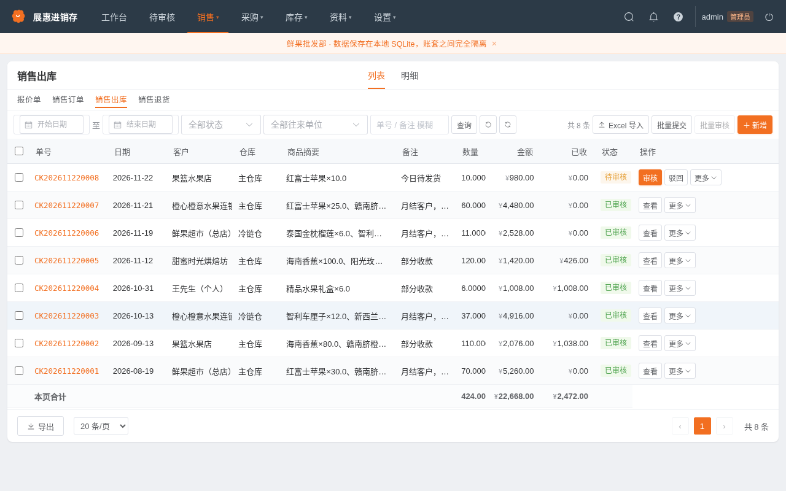
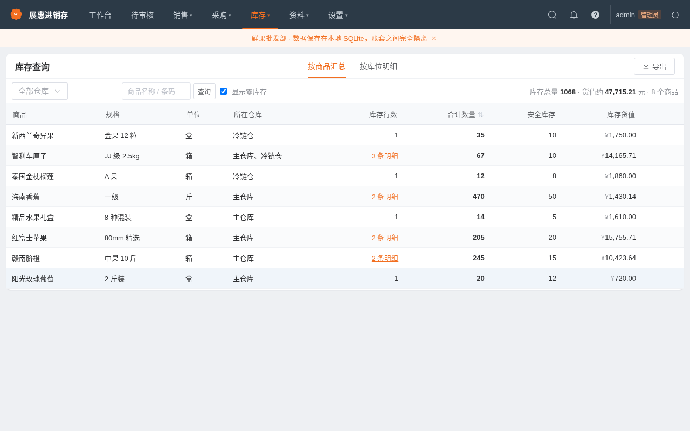
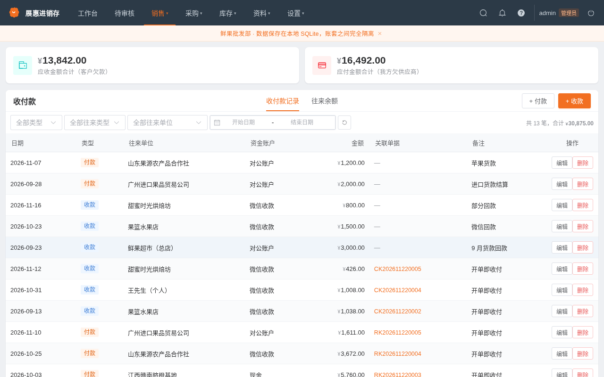
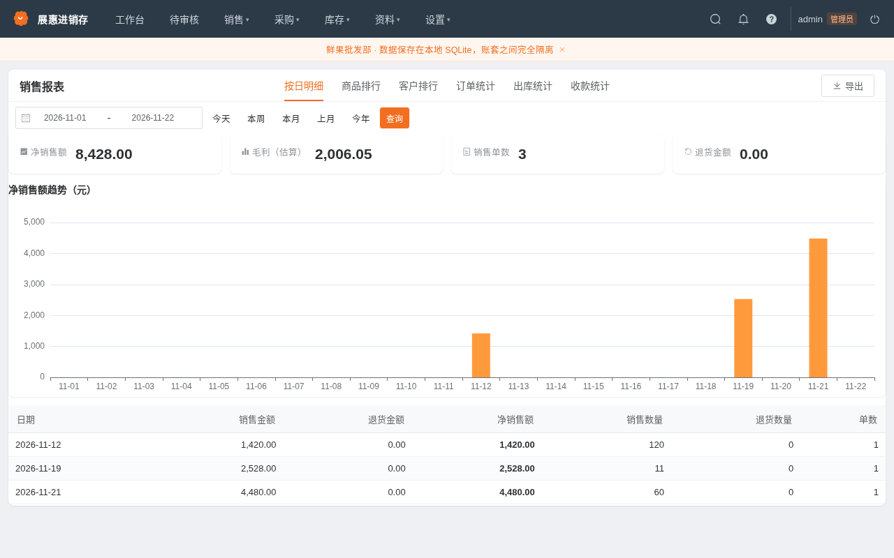
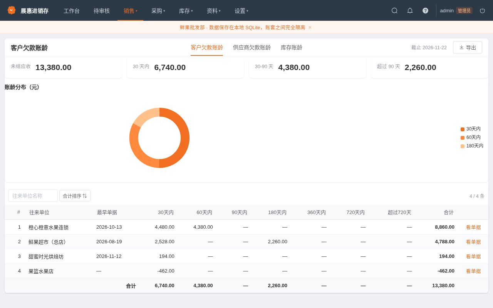

# 展惠进销存（zhanhui-jxc）

[中文](README.md) | [English](README_EN.md) | [架构设计](ARCHITECTURE.md)

面向小微批发与零售商户的企业级进销存管理系统：涵盖商品档案、采购入库、销售出库、调拨盘点、FIFO 批次成本、资金收付款、多维报表对账与操作审计追踪。

**v0.5.3** · **MIT License** · SQLite WAL 单机事务强一致性 · 零外部数据库 · 离线零构建前端 · 开箱支持容器与桌面端

---

## 截图演示


*工作台：库存 / 资金总览、低库存预警、近 14 天出入库趋势*


*销售出库单列表：已审核出库单、收款状态与页合计*


*库存查询：按仓库 + 商品查看实时库存与低库存警示*


*收付款：应收 / 应付总览、核销收付款与往来余额*


*销售统计报表：按日汇总金额、数量、单数与毛利*


*客户欠款账龄：按账龄区间定位逾期欠款*

---

## 核心特性与企业级能力

- **精准账务与并发安全**：金额以整数**分**运算（杜绝 IEEE 754 浮点漂移），数量保留 4 位小数；单据审核/作废/调拨/盘点/收付款均运行在 `BEGIN IMMEDIATE` 事务中，支持 FIFO 批次扣减与作废原子回滚，防止并发超卖与状态错乱。
- **高可靠接口与幂等保护**：统一异常码体系与 `{ error, code, requestId }` 响应契约；`POST /doc/create`、`POST /doc/audit`、`POST /doc/void` 与 `POST /settlement/create` 支持 `Idempotency-Key` 24 小时持久化幂等重放与参数冲突检测（`409`）。
- **认证授权与审计追踪**：scrypt 密码哈希、HMAC-SHA256 会话令牌（`HttpOnly; SameSite=Lax` Cookie + Bearer）、持久化令牌吊销、多租户团队隔离、DNS Rebinding Host 守卫、Cookie CSRF Origin 核验、RBAC 角色控制与管理员操作审计日志（设置 → 操作审计）。
- **版本化数据库与热备份**：内置 `schema_migrations`（V1–V3）、CLI 迁移/幂等种子脚本、基于 `VACUUM INTO` 的 WAL 在线热备份与恢复前完整性校验自动回滚。
- **可观测性与易部署**：结构化 JSON/可读日志（`AsyncLocalStorage` `requestId` 全链路透传 + 敏感字段自动脱敏）、`/health` 与 `/ready` 无鉴权探针、多阶段非 root `Dockerfile` + `docker-compose.yml` 与 GitHub Actions CI。

---

## 环境要求

- **Node.js ≥ 22.5**（推荐 Node 24 LTS，内置 `node:sqlite` 零原生编译依赖）
- **pnpm 12.x**（锁文件 `lockfileVersion 9.0`，配置见 `pnpm-workspace.yaml`）
- **Docker / Docker Compose**（可选，用于容器化生产部署）

---

## 环境变量配置

复制 `.env.example` 为 `.env` 后按部署场景调整（`.env` 已被 `.gitignore` 忽略，**严禁提交真实密钥**）。启动时通过 `server/src/config/env.ts` 校验配置，缺失或非法配置会快速失败。

| 变量名 | 默认值 | 说明 |
| --- | --- | --- |
| `NODE_ENV` | `development` | 运行环境：`development` \| `test` \| `production` |
| `PORT` | `7741` | HTTP 监听端口（1–65535 整数） |
| `ORANGE_BIND` | `127.0.0.1` | 绑定地址。默认仅本机回环；设为 `0.0.0.0` 等非回环地址时**强制要求**强随机 `ORANGE_JWT_SECRET` |
| `ORANGE_DATA_DIR` | `./data` | SQLite 主库 `huimin-clone.db`、备份目录 `backups/` 与开发期 `.jwt-secret` 存放目录 |
| `ORANGE_DB_PATH` | `<ORANGE_DATA_DIR>/huimin-clone.db` | 可选显式覆盖 SQLite 文件路径 |
| `ORANGE_JWT_SECRET` | 本机开发自动持久化随机生成 | JWT/HMAC 签名密钥（≥ 32 位高熵字符串，拒绝示例/占位/弱密钥）。**`production`、公网绑定或 `ORANGE_REQUIRE_SECRET=1` 下必填** |
| `ORANGE_REQUIRE_SECRET` | `0` | 设为 `1` 强制要求显式传入 `ORANGE_JWT_SECRET` |
| `ORANGE_ALLOW_HOSTS` | 空 | 允许访问的额外 Host 域名（逗号分隔，用于反代域名/内网穿透，如 `jxc.example.com`） |
| `ORANGE_COOKIE_SECURE` | `0` | Cookie `Secure` 标志：`0` \| `1` \| `auto`（`auto` 按 `X-Forwarded-Proto=https` 自动开启） |
| `ORANGE_TRUST_PROXY` | `0` | 反向代理跳数（`0`=关闭；`1..20`=受信任代理跳数，也可兼容 `false`/`true`）；置于 Nginx/Caddy 后建议设为 `1` |
| `LOG_LEVEL` | `info` | 日志输出级别：`debug` \| `info` \| `warn` \| `error` |
| `LOG_FORMAT` | `pretty`（`production` 下默认 `json`） | 日志格式：`pretty` \| `json` |
| `BACKUP_KEEP_COUNT` | `30` | 自动保留最新备份份数（1–365 整数） |

生成强随机 `ORANGE_JWT_SECRET`：

```bash
node -e "console.log(require('crypto').randomBytes(32).toString('hex'))"
```

---

## 从零启动与使用

### 1. 本地源码开发与运行

```bash
pnpm install
cp .env.example .env

# 编译后端 TypeScript -> dist/
pnpm run build

# （可选）初始化/迁移数据库并写入初始账号（CLI 不要求 ORANGE_JWT_SECRET；production 需提供符合强度要求的 SEED_ADMIN_PASS）
pnpm run db:migrate
SEED_ADMIN_PASS='YourStrongPass!2026' pnpm run db:seed

# 启动服务（默认 http://127.0.0.1:7741）
pnpm run serve
# 或热开发模式：pnpm run dev:server
```

- 打开浏览器访问 <http://127.0.0.1:7741>。若数据库为空，系统将自动引导完成首个团队账套与管理员账号初始化；若已执行演示数据重建 (`node tools/rebuild-clean.cjs`)，演示账号为 `admin / B2cost!9Xq`（**仅限本地演示，严禁用于生产**）。

### 2. Docker 容器化生产部署

```bash
# 1) 配置生产密钥（至少 32 位随机串）与反代域名
cat > .env << 'EOF'
ORANGE_JWT_SECRET=<使用 crypto.randomBytes(32).toString('hex') 生成>
ORANGE_ALLOW_HOSTS=localhost,127.0.0.1,jxc.example.com
ORANGE_COOKIE_SECURE=auto
ORANGE_TRUST_PROXY=1
LOG_FORMAT=json
LOG_LEVEL=info
EOF

# 2) 构建并启动容器（非 root 用户 node 运行，数据持久化在 zhanhui_data 卷）
docker compose up -d --build

# 3) 验证存活与数据库就绪状态
curl -fsS http://127.0.0.1:7741/health
curl -fsS http://127.0.0.1:7741/ready
```

### 3. Windows 桌面端（Electron）

- 开发启动桌面壳：`pnpm run build && pnpm run dev:electron`
- 安装包/便携版构建与发版流程见 `.github/workflows/release.yml` 与 [docs/deployment.md](docs/deployment.md)；用户操作指南见 [docs/使用手册.md](docs/使用手册.md)。

---

## 质量检查与测试命令

```bash
pnpm run lint              # ESLint 全仓代码规范检查 (server / electron / web/js)
pnpm run typecheck         # TypeScript 严格类型检查 (noEmit)
pnpm run format:check      # Prettier 代码风格检查
pnpm run build             # 编译后端 TypeScript 至 dist/
pnpm run test:unit         # 单元与特征测试（配置校验、加密原语、精度数学、事务与脱敏日志）
pnpm run test:integration  # 进程内 HTTP 集成测试（安全守卫、并发防超卖、幂等键、RBAC、审计、健康探针）
pnpm audit --audit-level=high  # 依赖安全漏洞审计

# 端到端全量业务回归（45 个接口 + Playwright 浏览器脚本，要求服务监听在 7741，建议指定隔离 ORANGE_DATA_DIR）
node tools/run-tests.cjs
node tools/run-tests.cjs --with-rounds   # 额外纳入 4 组专项对抗套件（共 49 个脚本）
```

---

## 健康检查与可观测性

- **`GET /health`**（及 `/api/health`）：进程存活性探针，无需鉴权，返回服务名称、版本、PID 与运行时长。
- **`GET /ready`**（及 `/api/ready`）：就绪探针，无需鉴权，实时探测 SQLite `SELECT 1` 与当前迁移版本 (`schemaVersion`)；数据库不可用时返回 `503 SERVICE_UNAVAILABLE`。
- **请求追踪与脱敏日志**：所有响应返回 `X-Request-Id`，服务端日志以单行 JSON（生产默认）记录每个请求的 `requestId`、`teamId`、`userId`、耗时与状态，并自动将密码、Token、Cookie、Secret 等字段掩码为 `[REDACTED]`。

---

## 目录结构

```text
server/src/          TypeScript 后端源码（37 个模块 + schema.md）
  index.ts           入口：配置初始化、单实例锁、port.txt、异步 Gzip、优雅停机
  app.ts             Express 应用装配工厂（解耦监听，供生产与测试复用）
  config/env.ts      环境变量加载与快速失败校验
  infra/             通用基础设施（errors / validate / tx / logger / audit-log / idempotency）
  middleware/        安全与权限中间件（requestId / Host 守卫 / CORS / CSRF / 安全头 / RBAC）
  shared/            通用业务数学与导出转义（money / csv）
  services/          核心领域服务（doc-service / stock-service / product-import-service）
  routes/            HTTP 路由层（health / docs / archives / audit 等）
  db.ts              SQLite WAL 初始化、版本化迁移 (V1–V3) 与恢复替换
server/tests/        单元测试与 HTTP 集成测试套件（node:test）
web/                 离线零构建前端（index.html, css/app.css, js/ 31 个组件脚本, vendor/）
electron/            Electron 桌面主进程、托盘管理与子进程守护
tools/               迁移/种子 CLI（db-migrate / db-seed）、数据重建与全量回归测试套件
.github/workflows/   CI（ci.yml）与 Windows 发版流水线（release.yml）
```

---

## 来源声明与许可证

本项目「展惠进销存」界面与业务流参考「惠民云」产品并由独立原创代码实现；旧品牌锚点仅保留用于升级兼容（`ORANGE_*` 环境变量与旧目录自动迁移）。完整声明见 [NOTICE.md](NOTICE.md)，以 [MIT License](LICENSE) 发布。
