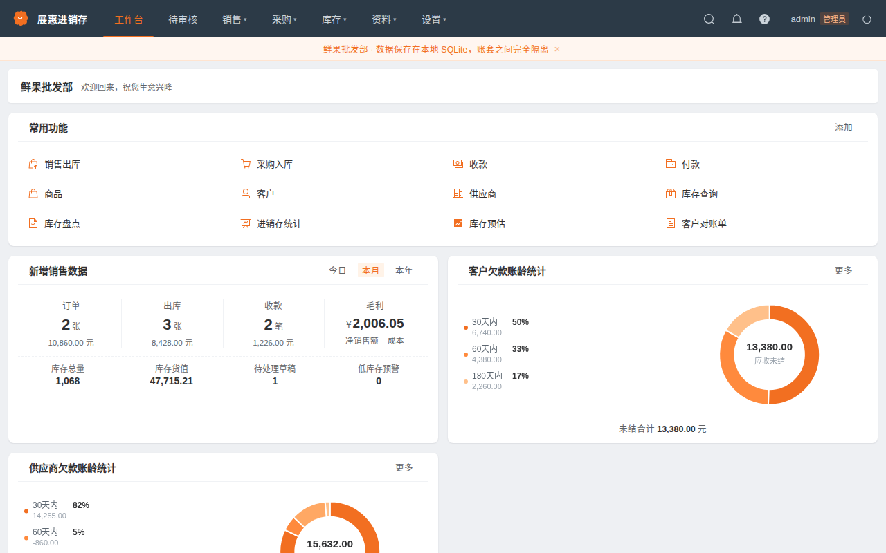
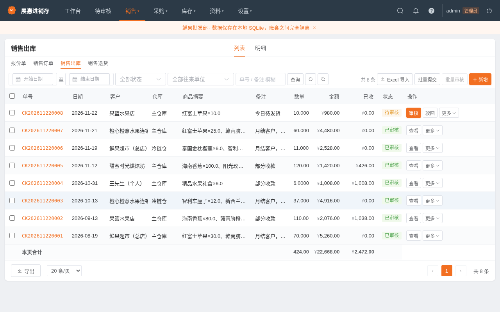
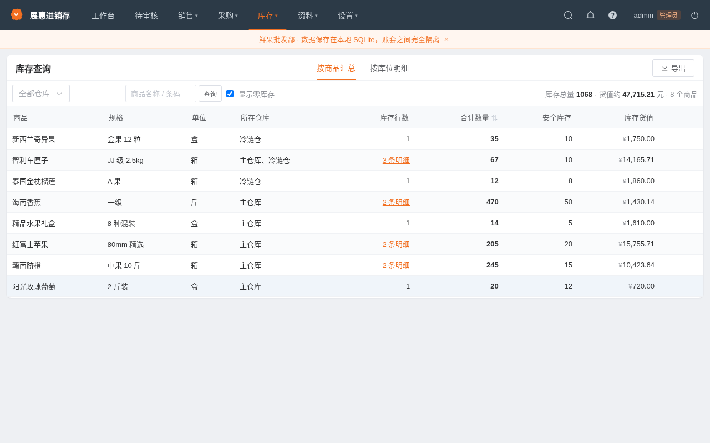
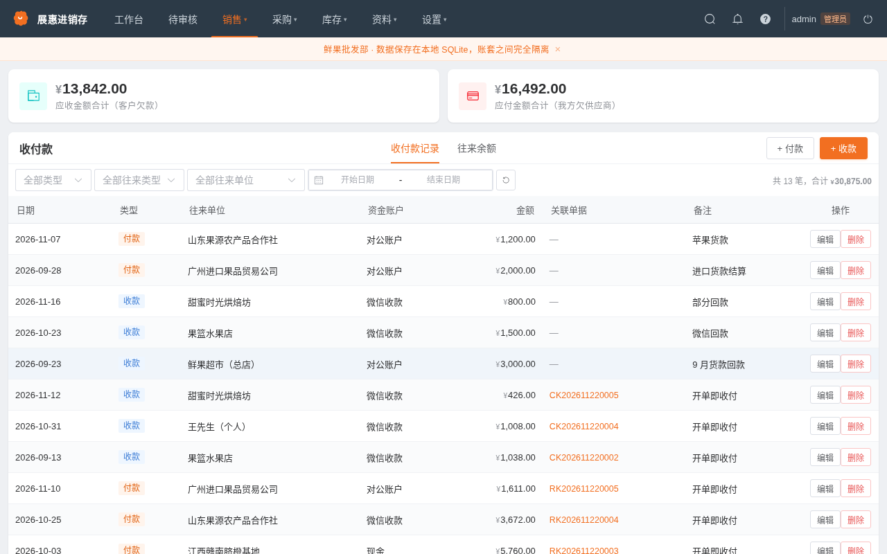
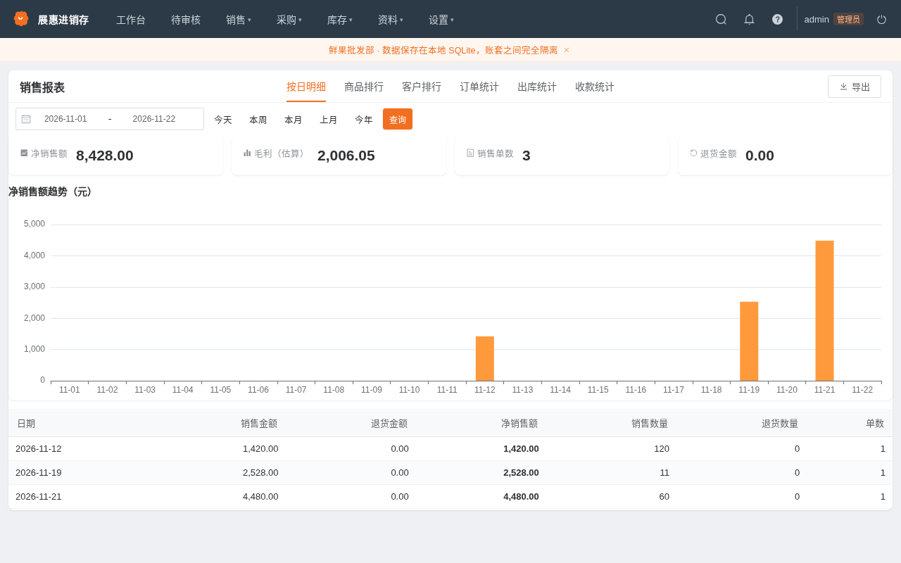
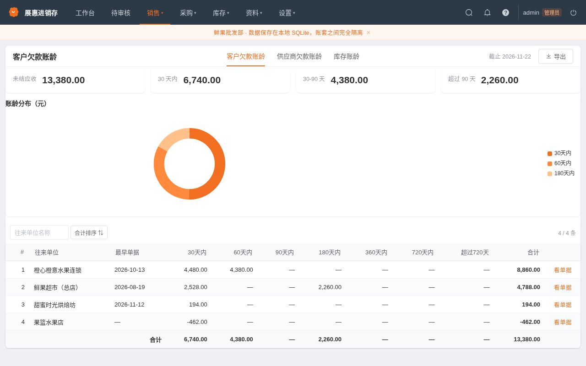

# Zhanhui JXC （展惠进销存）

[中文](README.md) | [English](README_EN.md)

An inventory and sales management system for small wholesale / retail businesses: product catalog, purchase receiving, sales shipping, transfers and stocktaking, settlements, and reconciled reports — a complete document flow + stock ledger + partner balances in one app.

**v0.5.2** · **MIT License** · Zero external database · Zero-build frontend · Localhost-only by default

---

## Screenshots


*Dashboard: stock / cash overview, low-stock alerts, 14-day in/out trend*


*Sales shipment list: audited shipping documents, receipt status and page totals*


*Stock lookup: stock by warehouse + product, low stock highlighted in red*


*Receipts and payments: receivable / payable totals, record receipts and payments, partner balances*


*Sales statistics report: amounts, quantities, order counts and gross-profit estimates by date range*


*Customer aging: receivables bucketed by age, so overdue balances stand out*

---

## About

Zhanhui JXC gives small wholesale / retail shops a ready-to-use bookkeeping tool: catalog setup, documents, audit posting, stock, partner balances and reports, all in one application.

- **Zero external database**: all data lives in a single SQLite file — copy the file and you have a backup.
- **Zero-build frontend**: Vue 3 + Element Plus + ECharts are all hosted locally. No CDN, no build step, works offline.
- **Localhost by default**: the service only listens on `127.0.0.1` and exposes nothing to the network; exposing it requires a strong random secret first (see [Security](#security)).
- **Books stay consistent**: a document only affects stock and partner balances once it is audited and posted; an audited document cannot be edited — it must be voided (which reverses all its effects) and re-issued, so every change is traceable.

---

## Features

| Module | Contents |
| --- | --- |
| Dashboard | Stock / cash overview, low-stock alerts, 14-day in/out trend, business KPIs, quick-create shortcuts |
| Sales | Quotations, sales orders, sales shipments, sales returns + order / shipment / receipt / gross-profit statistics + customer statements + customer aging |
| Purchasing | Purchase orders, purchase receipts, purchase returns + purchase statistics + supplier statements + supplier aging |
| Stock | Opening stock, misc in/out, assembly, transfers, adjustments, stocktaking, shipment requests, production tasks + stock lookup, in/out details / statistics, stock aging, stock forecast |
| Catalog | Customers, suppliers, products, product units, product categories, customer prices (remembered prices), master data (warehouses / locations / salespeople / cash accounts) |
| Settings | Document numbering rules, print headers, users and roles, invite-code registration, backup and restore |

**Posting rules**: documents have four states — draft / pending approval / audited / voided; only an audited document affects stock and partner balances. Outbound documents check stock on audit and are rejected when stock is insufficient; batched products are deducted first-in-first-out (FIFO). Barcode scanning, per-customer remembered prices (one price per customer), Excel / CSV document import and bulk product import are supported.

---

## Quick start

### Option A: Run from source (for development / testing)

```bash
pnpm install
pnpm build              # compile TypeScript to dist/
node dist/server/index.js
# or: pnpm serve        (same as above)
```

Open <http://127.0.0.1:7741> in a browser. Requires **Node.js ≥ 22.5** (the version that introduced `node:sqlite`).

- Hot-reload the backend with `pnpm dev:server` (ts-node runs the TypeScript directly, no build needed).
- The data directory defaults to `data/` under the current working directory; override it with `ORANGE_DATA_DIR`.

### Option B: Windows installer (recommended for end users)

Run `展惠进销存-Setup-<version>.exe` (installs to `%LOCALAPPDATA%\HuiminYun` by default), then double-click the desktop shortcut. No Node.js installation is needed and no terminal window pops up. Data lives in `%APPDATA%\huimin-yun` and survives reinstalls, upgrades and uninstalls.

### Option C: Portable edition (USB / no install)

Copy the whole `installer/payload/` directory (it bundles its own `node.exe`) and double-click `展惠进销存.exe` inside it; data lands in `data/` under the program directory and moves with it.

### First run

On first launch the database is empty and the app opens the "create workspace" flow (no invite code needed the first time): enter a username, a password (at least 6 characters) and a workspace name, click "Create workspace", and you are logged in to the dashboard.

**Want demo data right away?**

```bash
node tools/rebuild-clean.cjs
```

This rebuilds a clean workspace （鲜果批发部 / Fresh Fruit Wholesale) with demo catalog data: 2 warehouses / 3 locations / 3 cash accounts / 4 categories / 5 units / 2 salespeople / 8 products / 5 customers / 3 suppliers. Demo admin: `admin / B2cost!9Xq` (**demo only — change the password immediately for real use**).

For step-by-step instructions, posting rules and FAQs (Chinese only), see the [user manual](docs/使用手册.md).

---

## Tech stack

| Layer | Technology |
| --- | --- |
| Backend | Node.js + Express 4 + `node:sqlite` (built into Node, zero native dependencies, zero external database) |
| Backend language | TypeScript (`server/src/`, 18 modules + `schema.md`), compiled with `tsc` to `dist/` |
| Frontend | Vue 3.5.13 + Element Plus 2.9.3 (full build) + Icons 2.3.1 + ECharts 5.6.0, all in `web/vendor/` and loaded offline (31 frontend scripts, no build step) |
| Tests | Hand-written Node regression scripts (`tools/test-*.cjs`); UI end-to-end tests use Playwright |

Versions and SHA256 hashes of the offline vendor libraries: [web/vendor/VERSIONS.md](web/vendor/VERSIONS.md).

---

## Test status

```bash
pnpm build                     # compile TypeScript
node tools/rebuild-clean.cjs   # rebuild a clean workspace (recommended before testing)
pnpm test                      # one-shot regression: rebuild workspace + run all test scripts, exit code summarised at the end
node tools/run-tests.cjs --no-rebuild    # run tests without rebuilding the workspace
node tools/run-tests.cjs --with-rounds   # additionally include the adversarial test suites
```

- **Scale**: 49 regression scripts in total (`--with-rounds` runs all 49; the default run covers 45, excluding the 4 `test-round*` suites).
- **Latest result** (v0.5.2 + enterprise hardening from PR #3, after merge): `tsc --noEmit` reports 0 errors; full regression **46/49 passed, 3 skipped, 0 failed** (the 3 skipped are UI end-to-end tests, which need a browser).
- **Coverage**: all document types and conversions, posting and void reversals, settlements and edits, reports and statements, import (MVP / robustness / security), permission escalation, approval flows, aging, business-date validation, backup retention, and UI end-to-end.
- `pnpm test` needs the service running on `7741` (or the port recorded in `port.txt`); override the base URL with `OC_BASE=http://127.0.0.1:7741/api`.

---

## Data and backup

- **Data file**: `<data directory>/huimin-clone.db` (a single SQLite file, possibly with `-wal` / `-shm` sidecars in the same directory).
- **Manual backup**: just copy the `.db` file.
- **In-app backup** (Settings → Backup, admins only): "Back up now" snapshots the whole database after a WAL checkpoint into `<data directory>/backups/`, keeping the latest 30 copies; "Download" saves a copy elsewhere; "Restore" asks for the current account password again, then restarts the service with data rolled back to that backup (irreversible — back up the current state first).
- **Upgrades never lose data**: reinstalling or upgrading only replaces program files; the data directory is left untouched, and uninstalling keeps the workspace data too.
- **Migration from old versions**: data from v0.2.x lives in `%APPDATA%\orange-jxc` (database `orange-clone.db`) and is migrated automatically on first launch to `%APPDATA%\huimin-yun` (renamed to `huimin-clone.db`): WAL merged first, then copy, then size check, and only then is the old directory removed. Any step failing leaves the old directory in place and keeps using it.

---

## Security

- **Localhost by default**: the service only listens on `127.0.0.1`. Before exposing it to a LAN, the public internet or a tunnel, **set a strong random `ORANGE_JWT_SECRET`** and also set `ORANGE_REQUIRE_SECRET=1` (refuses to start without a secret). Full steps: [docs/deployment.md](docs/deployment.md).
- **Tokens**: login tokens are issued as httpOnly cookies (7-day lifetime, SameSite=Lax) that browser JavaScript cannot read; logout truly revokes the token, and changing a password invalidates old tokens immediately.
- **Host whitelist**: only `127.0.0.1` / `localhost` / loopback IPs are accepted by default, blocking DNS rebinding; tunnel or reverse-proxy domains must be added via `ORANGE_ALLOW_HOSTS`.
- **Data isolation**: the `teamId` in every request is overwritten with the team from the token, so cross-workspace calls cannot leak data.
- **Passwords**: scrypt hashing with constant-time comparison; login / registration are rate-limited per IP on failures.
- All of the above targets **single-machine self-hosted use** and is not a complete security boundary for public hosting.

---

## Project layout

```
server/src/     Backend source, split by business domain (18 .ts modules + schema.md)
  index.ts        Entry point, middleware (gzip / security headers / Host whitelist / CORS), listener and single-instance lock
  db.ts           Table creation, lightweight column migrations, business-date validation, local dates
  auth.ts         Login / registration / user management / invite codes / tokens
  docs.ts         Documents (purchasing, sales, transfers, stocktaking, …) and audit posting
  docimport.ts    Smart Excel / CSV document import
  stock.ts        Stock lookup and valuation
  settlement.ts   Receipt / payment settlements
  report.ts       Reports and statements
  aging.ts        Aging
  jxc-report.ts   In/out statistics / reconciliation
  dashboard.ts    Dashboard aggregation
  backup.ts       Backup and restore
  bill-no.ts      Document number generation (prefix config, sequence allocation)
  crud.ts         Generic CRUD factory (catalog tables list/create/update/delete)
  price.ts        Customer remembered prices (one price per customer, auto-applied)
  safe-handler.ts Async route wrapper (generic 500 responses)
  settings.ts     Feature settings (document numbering rules, print headers)
  xlsxlite.ts     Zero-dependency xlsx / CSV reader
web/            Frontend (no build step)
  index.html      Entry point
  js/             Vue components (31 scripts, loaded in dependency order)
  vendor/         Offline Vue / Element Plus / ECharts libraries
tools/          Test scripts, demo-data rebuild, service manager, packaging scripts
installer/      Inno Setup scripts and build output (payload/out are not committed)
launcher.cjs    Installer / portable-edition launcher
data/           Local SQLite database (gitignored, not committed)
```

---

## Changelog

Full history: [CHANGELOG.md](CHANGELOG.md).

- **v0.5.2 (2026-10-24)**: hotfix — double-clicking the desktop icon opened multiple browser windows; the launcher now uses a single-instance lock (atomic creation + liveness check).
- **Enterprise hardening (2026-11-21 to 2026-11-22, [PR #3](https://github.com/070310-lizhanqi/huimin-jxc/pull/3))**: after a deep review, 63 changes landed in four batches (27 tier-A items fixed immediately + 36 tier-B items fixed after adding tests first; 16 tier-C items deliberately untouched). Highlights: body-parser high-severity vulnerability fixed, deployment checks for the default JWT secret, void-settlement gap closed, token-type validation, persistent logout revocation, unified cost basis, pre-restore backup integrity checks, import N+1 elimination, catalog indexes (name lookup 657ms → 6ms), server-side pagination (stock list 948KB → 10KB), bulk export (10k documents: 50 requests in 1978ms → 1 request in 133ms), tokens moved to httpOnly cookies, and documentation / version figures corrected. After merge, full regression: 46/49 passed, 0 failed.

---

## Attribution

The user interface and business flows of "Zhanhui" reference the "惠民云" inventory product; the code is an independent original implementation, made without authorization from the original product. The project was renamed to "Zhanhui" to avoid trademark confusion; legacy brand strings remain only as compatibility anchors: `ORANGE_*` environment variable names, the old data-directory migration paths (e.g. `%APPDATA%\orange-jxc` / `orange-clone.db` → `%APPDATA%\huimin-yun` / `huimin-clone.db`), and the installer `AppId`. Full statement: [NOTICE.md](NOTICE.md).

Released under the MIT License (see [LICENSE](LICENSE)).
